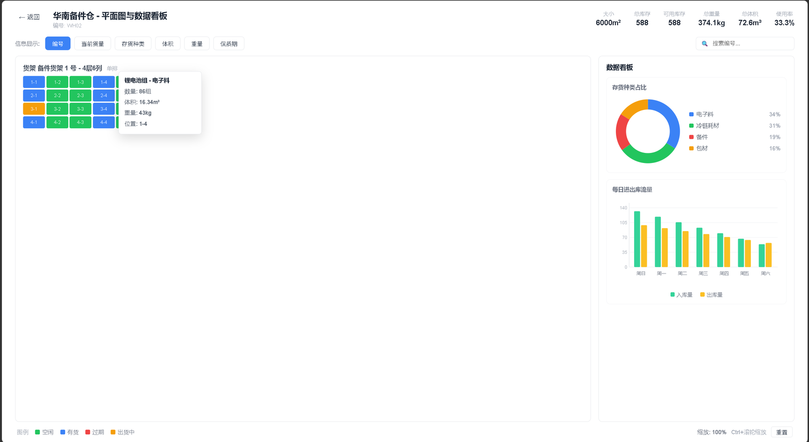
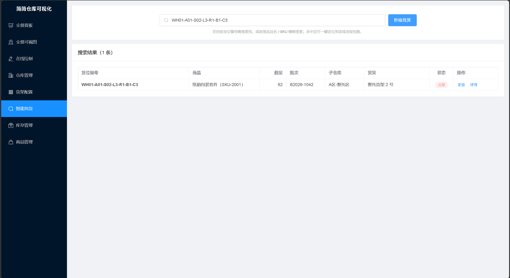

# 简简仓库可视化系统（Warehouse Visualization）

面向中小仓储的 ToB 可视化工具：在线绘制仓库平面图、参数化生成货架与货位、货位四态可视化、智能找货定位，配套全景看板与数据看板。





| 项目信息 | 说明 |
|---------|------|
| **技术栈** | SpringBoot 3.2.5 · MyBatis-Plus 3.5.7 · MySQL 8 · Vue 3.5 · Vite 5 · Element Plus 2.8 · ECharts 5 |
| **核心能力** | SVG 平面图绘制 · 货架参数化批量生成货位 · 货位四态着色 · 智能找货定位 · 全景与数据双看板 |
| **启动方式** | 双击 `启动系统.bat`（jar 独立运行，不依赖 IDEA/Maven），或 `bash mvn.sh spring-boot:run` |
| **项目文档** | `docs/` 下含需求文档、设计文档、测试文档、开发计划表四份 |
| **源码** | 本仓库 |

## 技术栈

| 端 | 技术 |
|---|---|
| 后端 | SpringBoot 3.2.5 + MyBatis-Plus 3.5.7 + **MySQL 8** + Lombok + Validation |
| 前端 | Vue 3.5 + Vite 5 + Element Plus 2.8 + Axios + ECharts 5 + vue-router 4 |

**数据库配置**（`warehouse-backend/src/main/resources/application.yml`）：

```yaml
url: jdbc:mysql://${DB_HOST:...}:${DB_PORT:3306}/warehouse_data
username: ${DB_USER:root}
password: ${DB_PASSWORD:root}
```

地址、账号、密码均支持环境变量 `DB_HOST` / `DB_PORT` / `DB_USER` / `DB_PASSWORD` 覆盖；不设时使用 yml 里的默认值（作者的开发环境），换机器时把默认值改成你自己的 MySQL 地址即可，无需改代码。

启动时自动执行 `db/schema.sql` + `db/data.sql` 完成建表与演示数据插入——两个脚本都是**幂等**写法（`CREATE TABLE IF NOT EXISTS` / `ON DUPLICATE KEY UPDATE`），重启不会重复插入、也不会清空你已有的数据。首次启动还会由 `DataInitializer` 按货架参数生成货位并填充库存。
如需切回本地 H2 文件库，把 yml 里 H2 那 4 行注释打开即可（不用改任何代码）。

## 目录结构

```
仓库可视化代码实现/
├── mvn.sh                      # Maven 启动包装脚本（绕过本机 mvn 脚本故障）
├── warehouse-backend/          # 后端（端口 8081）
│   ├── settings.xml            # 阿里云镜像（加速依赖下载）
│   └── src/main/
│       ├── java/com/warehouse/
│       │   ├── common/         # Result / PageResult / 异常处理
│       │   ├── config/         # MP 分页 / 跨域 / 时间填充 / 演示数据初始化
│       │   ├── entity/         # 9 张表实体
│       │   ├── mapper/         # BaseMapper + 聚合/联查注解 SQL
│       │   ├── dto/            # 货架批量生成 / 入库请求
│       │   ├── service/        # 10 个业务服务
│       │   └── controller/     # 10 个 REST 控制器
│       └── resources/
│           ├── application.yml
│           └── db/             # schema.sql（9 表）+ data.sql（主数据）
└── warehouse-admin/            # 前端（端口 5174，/api 代理到 8081）
    └── src/
        ├── api/                # base / shelf / stock / dashboard 四组 API
        ├── views/              # 6+2 个页面
        ├── components/         # LocationDetailDialog 货位详情弹窗
        └── utils/request.js
```

## 启动方式

### 方式 1：双击即用（推荐，无需命令行）

| 文件 | 作用 |
|---|---|
| **`启动系统.bat`** | 双击后自动检查并启动后端（jar 独立运行，不依赖 IDEA/Maven），再自动用浏览器打开前端页面 |
| **`停止系统.bat`** | 双击停止后端服务（释放 8081 端口） |

> 想更接近"双击一个 html 就打开"的体验：把 `warehouse-admin\dist\index.html` **右键 → 发送到 → 桌面快捷方式**，以后双击桌面图标即可。
> 前提是后端已在运行（可用 `启动系统.bat` 启动）。前端已做成 **hash 路由 + 相对资源路径 + 绝对 API 地址**，因此 `file://` 直接打开也能正常取数据（后端已开放跨域）。

### 方式 2：开发模式（改代码时用）

```bash
# 后端（Git Bash，仓库根目录）
bash mvn.sh spring-boot:run

# 前端（另开终端）
cd warehouse-admin
npm install   # 首次
npm run dev
```

访问：http://localhost:5174

### 方式 3：只更新前端静态产物

```bash
cd warehouse-admin && npm run build     # 产物输出到 dist/
```

> 演示数据：仓库 2 个、子仓库 4 个、货架 5 个、货位按参数自动生成（约 87 个）、其中约 1/3 含库存。

### 用 IDEA 运行（推荐）

1. 用 IDEA 打开 **`仓库可视化代码实现` 根目录**，IDEA 会识别到根目录的聚合 `pom.xml`，右下角弹窗点 **「作为项目导入 / Load Maven Project」**。
2. 等 Maven 依赖导入完成（右侧 Maven 面板能看到 `warehouse-backend` 模块）。
3. `文件 → 项目结构 → 项目 → SDK` 选择 **JDK 17**。
4. 打开 `warehouse-backend/src/main/java/com/warehouse/WarehouseApplication.java`，点左侧绿色 ▶ 运行。
5. 控制台出现 `Started WarehouseApplication` 即成功。

> **常见坑**：只把仓库根目录当普通文件夹打开、没有导入 Maven 模块时，IDEA 不会加载任何依赖，会满屏报「程序包 com.baomidou... 不存在 / 程序包 lombok 不存在」。解决办法就是上面第 1 步——右键 `warehouse-backend/pom.xml`（或根目录 `pom.xml`）→ **「添加为 Maven 项目」**。
>
> Lombok 注解报错：`设置 → 插件` 确认 Lombok 已启用，并到 `设置 → 构建、执行、部署 → 编译器 → 注解处理器` 勾选「启用注解处理」。

## 已实现功能（对照需求文档 6 界面）

| # | 界面 | 路由 | 实现要点 |
|---|------|------|----------|
| 1 | 全景可视化看板 | `/dashboard` | 统计卡片 + SVG 平面图子仓库区块（按利用率着色）+ ECharts 柱状/饼图，双击区块下钻 |
| 2 | 仓库基础信息管理 | `/warehouse` | 仓库 / 子仓库 / 库管人员三 Tab 完整 CRUD |
| 3 | 仓库平面图绘制 | `/layout/:warehouseId` | SVG 画布框选绘制区域、拖拽移动、属性面板实时调整、图片图纸导入为背景图 |
| 4 | 货架配置 | `/shelf` | 参数化配置（单双排/行/排/列/层）+ SVG 实时预览（含双排通道线），一键批量生成货架与货位 |
| 5 | 区域货架视图 | `/region/:subId` | 按层切换货位网格，四态着色（空闲/占用/锁定/禁用），点击货位弹详情，支持找货高亮定位 |
| 6 | 智能找货 | `/search` | 货位编号精准 + 商品名/SKU 模糊搜索，秒级返回，一键跳转区域视图高亮目标货位 |
| + | 库存管理 | `/inventory` | 库存分页查询、入库（同货位同批次自动合并并占用货位）、数量调整、删除释放货位 |
| + | 商品管理 | `/goods` | 商品 SKU 完整 CRUD |
| 7 | 仓库全景可视图 | `/panorama` | 全屏白色画布展示所有仓库卡片（总库存/可用库存/使用率/状态点），悬停弹详情（冻结库存、出入库量、主要存货种类等），双击进入数据看板 |
| 8 | 平面图与数据看板 | `/panorama/warehouse/:id` | 头部统计（总重量/总体积/使用率等）+ 信息显示 6 模式切换（编号/当前货量/存货种类/体积/重量/保质期）+ 搜索即定位高亮 + 货位悬停详情 + 右侧种类占比环形图与每日进出库流量柱状图 + Ctrl+滚轮缩放 |

## 接口清单（前缀 /api）

- 仓库：`GET /warehouse/page|/warehouse/all|/warehouse/{id}`、`POST/PUT /warehouse`、`DELETE /warehouse/{id}`
- 子仓库：`GET /sub-warehouse/page|/by-warehouse/{id}`、`POST/PUT`、`DELETE /{id}`
- 库管：`GET /user/page|/user/all`、`POST/PUT`、`DELETE /{id}`
- 平面图：`GET /layout/by-warehouse/{id}`、`POST /layout/save`、`POST /layout/import`（multipart）
- 货架：`GET /shelf/page|/by-sub/{id}`、`POST /shelf/batch`（批量生成货位）、`PUT`、`DELETE /{id}`
- 货位：`GET /location/by-shelf/{id}`、`GET /location/{id}`（含库存明细）
- 商品：`GET /goods/page|/goods/all`、`POST/PUT`、`DELETE /{id}`
- 库存：`GET /inventory/page`、`POST /inventory/inbound`、`PUT /inventory/{id}?quantity=`、`DELETE /inventory/{id}`
- 看板：`GET /dashboard/warehouse/{id}`、`GET /dashboard/sub/{id}`
- 全景可视图：`GET /panorama/overview`、`GET /panorama/warehouse/{id}`
- 找货：`GET /search?keyword=`

## 说明与边界

- 设计文档中「CAD/手绘图智能识别」需接入第三方 OCR/CAD 解析服务，本实现支持导入图片图纸作为背景图并在其上继续绘制（`source_type` 已预留）。
- 货位编码规则：`仓库编码-子仓编码-货架编码-L层-R行-B排-C列`（如 `WH01-A01-S01-L1-R1-B1-C1`）。
- 所有删除均为逻辑删除（`deleted` 字段）；货架下有占用货位时禁止删除/调整结构参数。
